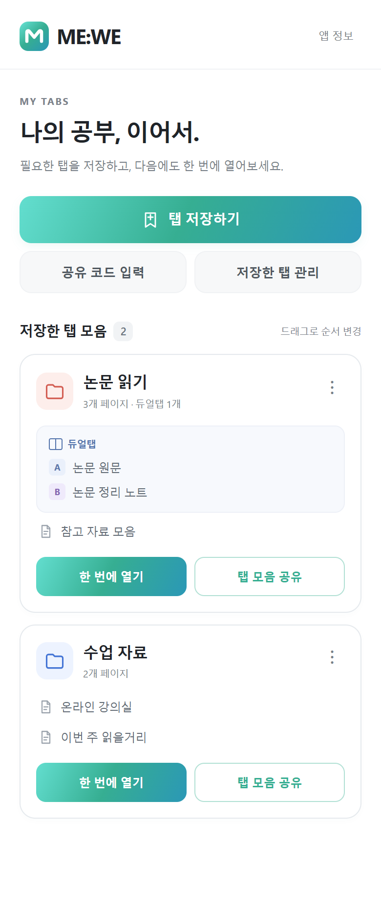
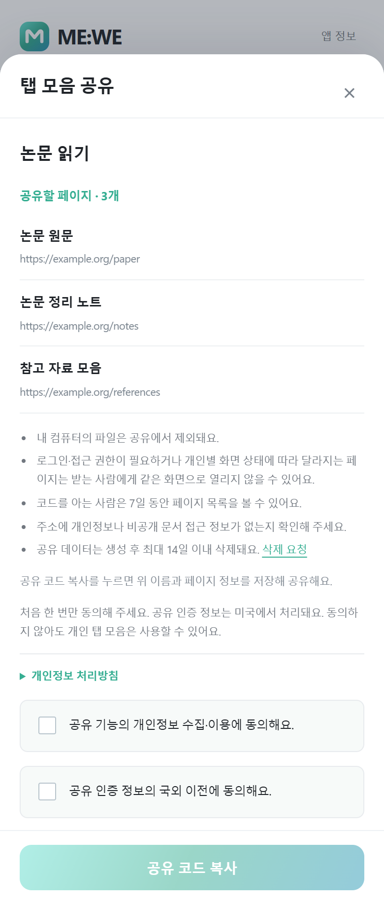

# ME:WE

**열어둔 페이지를 탭 모음으로 저장하고, 필요할 때 다시 열어보세요.**

네이버 웨일의 사이드바에서 학습 페이지를 모아두고, 듀얼탭 구성까지 다시 여는 탭 모음 앱입니다.

운영팀 **ewhale** · 개발자 **정희진** · 현재 버전 **0.3.1** · **웨일스토어 출시 준비 중**

[사용 가이드](docs/user-guide.md) · [개인정보 안내](PRIVACY.md) · [변경 이력](CHANGELOG.md) · [개발 문서](docs/development.md)

## 화면

 

앱에 예시 데이터를 넣어 촬영한 화면입니다. 메인색은 이화 민트(`#36AE92`), 로고는 둥근 사각형 안의 흰색 M입니다. UI 변경 시 촬영 절차에 따라 이미지를 갱신합니다.

## 주요 기능

| 기능 | 할 수 있는 일 |
| --- | --- |
| 탭 저장하기 | 현재 창의 페이지를 선택해 새 탭 모음을 만들거나 기존 탭 모음 뒤에 추가 |
| 듀얼탭 복원 | 좌우 페이지를 A/B로 구분하고 나란히 다시 열기 |
| 열기·닫기 | 저장한 페이지를 열고, 앱으로 연 탭만 함께 닫기 |
| 수정·정렬 | 페이지 추가·제거, 이름 변경, 카드 드래그로 순서 변경 |
| 로컬 파일 | 내 컴퓨터의 PDF 등 파일 주소 저장 |
| 코드 공유 | 웹페이지 목록을 12자리 코드로 전달하고, 코드를 붙여넣어 미리보기 후 저장·바로 열기 |

탭 모음 개수에는 앱에서 정한 제한이 없습니다. 탭 모음 하나에는 최대 10페이지를 저장하며, 브라우저 저장 용량의 제한은 적용됩니다.

## 설치하기

스토어 공개 전에는 개발자 모드로 설치할 수 있습니다.

**[설치용 앱 ZIP 받기](https://github.com/heejin0316/mewe-naver-whale/raw/refs/heads/main/delivery/MEWE-0.3.1.zip)** · [아이콘·스크린샷·제출 안내](delivery/) · [최종 검증 결과](docs/final-review.md)

1. 위의 **설치용 앱 ZIP**을 내려받아 압축을 풉니다.
2. 네이버 웨일 주소창에 `whale://extensions`를 입력합니다.
3. **개발자 모드 → 압축해제된 확장앱 설치**를 누릅니다.
4. 압축을 푼 폴더 중 **`manifest.json`이 있는 폴더**를 선택합니다.
5. 사이드바에서 **ME:WE**를 엽니다.

팀원 설치와 스토어 업로드에는 동일한 앱 ZIP을 사용합니다. 저장소의 **Code → Download ZIP**은 개발 소스 전체이므로 스토어에 제출하지 않습니다. 심사 요청 전 [검증 결과](docs/final-review.md)와 [운영 점검](docs/release-checklist.md)을 확인하세요.

별도 빌드나 npm 설치가 필요하지 않습니다. **일반 사용자는 Firebase를 설정할 필요가 없습니다.** 공유 기능은 앱에 연결된 운영 서비스를 사용합니다.

업데이트할 때는 기존 설치 폴더의 파일을 갱신하고 확장앱 관리 화면에서 **새로고침**하세요. 탭 모음을 유지하려면 확장앱을 삭제하지 마세요. 설치한 폴더는 이동하거나 삭제하지 않는 것이 좋습니다.

## 빠르게 사용하기

1. 필요한 페이지를 열고 **탭 저장하기**를 누릅니다.
2. 포함할 페이지를 선택하고 **새 탭 모음 만들기**에서 이름을 입력하거나 **기존 탭 모음에 추가하기**에서 저장할 모음을 선택한 뒤 **저장**합니다.
3. **저장한 탭 모음** 카드에서 **한 번에 열기**로 다시 열고 **한 번에 닫기 → 모두 닫기**로 정리합니다. **저장한 탭 관리**를 누르면 수정·삭제 버튼이 표시되고, **관리 완료**로 돌아옵니다.
4. 함께 볼 웹페이지는 **탭 모음 공유**를 사용합니다. 받은 코드는 **공유 코드 입력 → 붙여넣기 → 탭 불러오기**로 확인하고 **저장** 또는 **바로 열기**를 선택합니다.

링크 입력 후 `Enter`로 추가하고, 저장 버튼에 초점이 옮겨진 뒤 다시 `Enter`로 저장할 수 있습니다. 이름이 비어 있으면 이름부터 입력합니다. 카드 순서는 드래그하거나 카드에 초점을 두고 `Alt + ↑/↓`로 바꿉니다.

## 데이터와 알아둘 점

- 개인 탭 모음은 기기에 저장하며 자동으로 서버에 업로드하지 않습니다.
- 공유 시 미리보기의 탭 모음 이름·웹페이지 정보 등을 서버에 저장합니다. 주소에 개인정보나 비공개 문서 접근 정보가 포함되어 있는지 확인하세요.
- 공유 코드는 **7일간 유효**합니다. 담당자가 만료 문서를 매주 정리하고 생성 후 **최대 14일 이내 삭제**합니다. 서버 자동 삭제와 앱 내 철회 기능은 없으며, 삭제 요청은 문의 이메일로 받습니다.
- 공유 기능 최초 이용 시 개인정보 수집·이용과 미국으로의 인증 정보 이전에 동의하면, 같은 브라우저의 공유하기·공유받기에 공통 적용합니다. 앱 정보에서 공유 사용을 중지할 수 있습니다. 동의하지 않아도 개인 탭 모음 기능은 사용할 수 있습니다.
- 로컬 파일은 **경로만 저장**하며 공유에서 제외합니다. 파일을 이동·삭제하면 열 수 없습니다. 로그인 상태와 문서 열람 권한도 전달되지 않습니다.
- 공유 전 안내에서 로컬 파일 제외와 로그인·접근 권한·기기 환경에 따른 화면 차이를 확인하세요. 공유본은 독립적인 복사본으로 이후 수정사항이 자동 반영되지 않습니다.
- **붙여넣기**는 클릭할 때만 클립보드 텍스트를 입력란에 채웁니다. **탭 불러오기** 전에는 조회하지 않으며, 유효한 공유 코드만 조회에 사용합니다.
- 듀얼탭 복원은 웨일 버전·설정에 영향을 받습니다. 실패하면 일반 탭으로 열고 안내합니다.
- 닫기는 앱이 이번 실행에서 추적한 탭에 적용됩니다. 브라우저 재시작·확장앱 새로고침 전의 탭은 닫기 대상이 아닙니다. 공유 미리보기의 **바로 열기**는 먼저 저장한 뒤 열어 해당 카드에서 닫을 수 있습니다.

처리 항목과 삭제 방법은 [개인정보 처리방침](PRIVACY.md)을 확인하세요. 시행일은 2026-10-23이며, Firestore 저장 위치는 서울입니다. 실제 삭제·요청 처리는 [운영 절차](docs/operations.md)를 따릅니다.

## 문의

- 사용 문의·버그: [GitHub Issues](https://github.com/heejin0316/mewe-naver-whale/issues)
- 개인정보·공유 데이터 삭제·보안 제보: **h33jin.jeong@gmail.com**

공개 이슈에는 공유 코드, 개인 URL, 로컬 파일 경로, 인증 토큰을 올리지 마세요. 보안 문제는 [보안 제보 안내](SECURITY.md)에 따라 이메일로 보내 주세요.

## 라이선스와 브랜드

코드와 문서는 [MIT 라이선스](LICENSE)를 따릅니다. 재사용·수정·상업적 배포가 가능하며 저작권 및 라이선스 고지를 유지해야 합니다.

**로고·앱 아이콘은 MIT 적용 대상에서 제외**됩니다. [브랜드 사용 정책](docs/brand-policy.md)과 [아이콘 권리 고지](assets/icons/LICENSE.txt)를 확인하세요. 수정한 앱을 배포할 때는 별도의 이름과 아이콘을 사용해 공식 배포본과 구분해 주세요.

ME:WE는 ewhale이 제작한 앱이며, 네이버 또는 이화여자대학교의 공식 앱이 아닙니다.

## 개발·출시 자료

[문서 전체 안내](docs/README.md) · [개발 및 테스트](docs/development.md) · [구조와 권한](docs/architecture.md) · [Firebase 운영 설정](FIREBASE_SETUP.md) · [기여 안내](CONTRIBUTING.md) · [스토어 제출 준비](docs/START-HERE.md)
